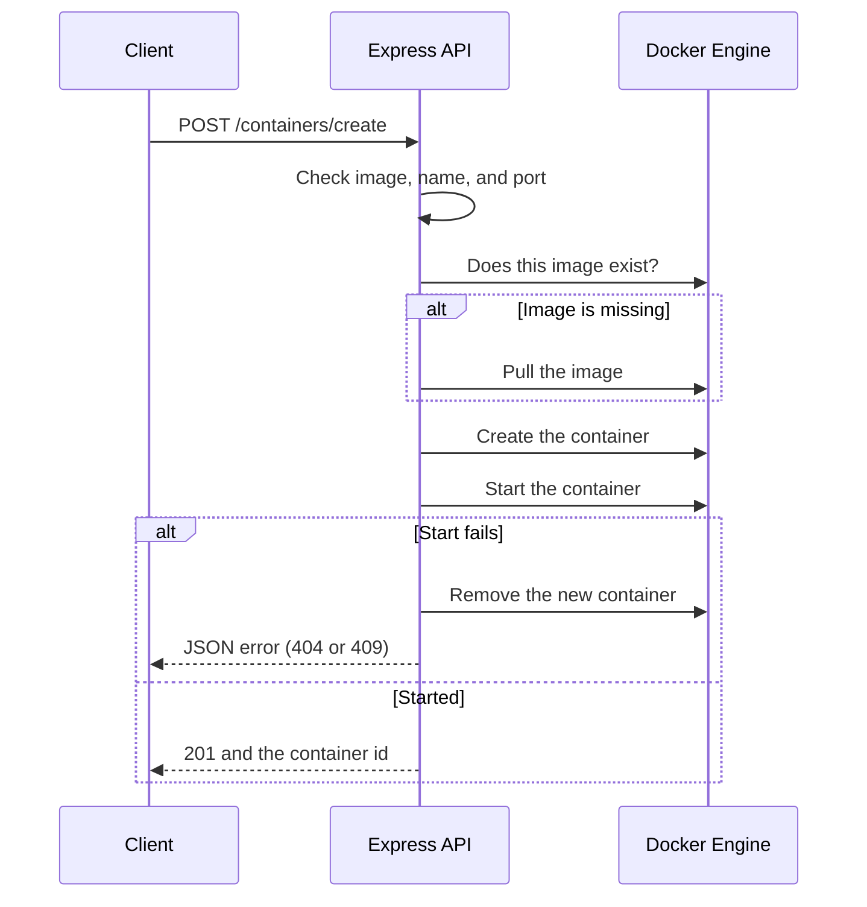

# Docker Dashboard API

Express API that manages the Docker engine on this machine. It listens on port **5000** and talks to Docker through Dockerode, using the local Docker socket.

```bash
npm install
npm run dev
```

`npm start` runs the server without auto-reload. Docker Desktop (or the Docker engine) must be running.

## Routes

| Method | Path | What it does |
|---|---|---|
| GET | `/` | Health check |
| GET | `/docker/info` | Container, image, and engine counts |
| GET | `/containers` | List containers |
| POST | `/containers/create` | Pull the image if needed, then create and start |
| POST | `/containers/:id/start` | Start |
| POST | `/containers/:id/stop` | Stop |
| POST | `/containers/:id/restart` | Restart |
| DELETE | `/containers/:id` | Remove |
| GET | `/volumes` | List volumes |
| POST | `/volumes/create` | Create a volume |
| DELETE | `/volumes/:name` | Remove a volume |
| GET | `/networks` | List networks |
| POST | `/networks/create` | Create a network |
| DELETE | `/networks/:id` | Remove a network |

A Postman collection for these routes is in `resorces/docker-dashboard.postman_collection.json`.

## Request flow

Creating a container is the fullest path. Other routes follow the same shape: Express checks the request, Dockerode calls the engine, and the route returns JSON.



The client never talks to Docker directly. `docker.js` opens one Dockerode connection, and each route uses it. If the engine is down, the API answers **503** instead of a raw socket error. A bad body, a missing image, a taken port, or a duplicate name comes back as JSON `{ "error": "..." }` with a matching status code.
